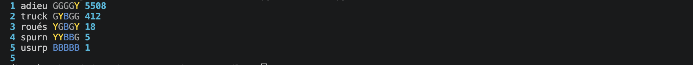
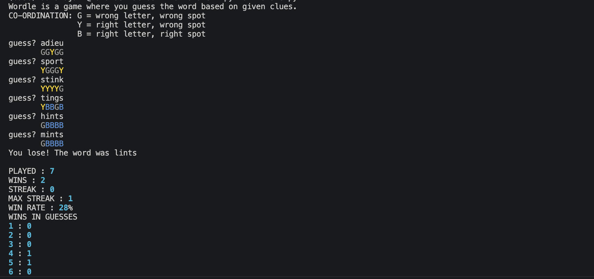

# Wordle
A recreation of the famous NYT daily game Wordle in Python where a person gets 6 tries to guess a 5 letter word.

# Try it here
Try it:

# Features
- Stats: shows games played, total wins, streaks, and other stats per player for total games played
- Color: for each guess, the result tells the letters in place via both color and letters
- Bot: a mini chatbot which plays using an optimized method
- Tests: have a seperate file to test and ensure all code was working

# Why I made it
I wanted to get out my coding block and jump back into python. So, I decided to go for a simple project that is easy to implement code wise. 

# What I learned
- adding color in Python
- creating json files in Python
    - learning how to edit and work with them
- how to write testing files
- how .gitignore is actually used
- improved logic behind functions + improved debugging rates
    - inverse functions, etc.
- learned json dictionaries don't accept integers as keys
